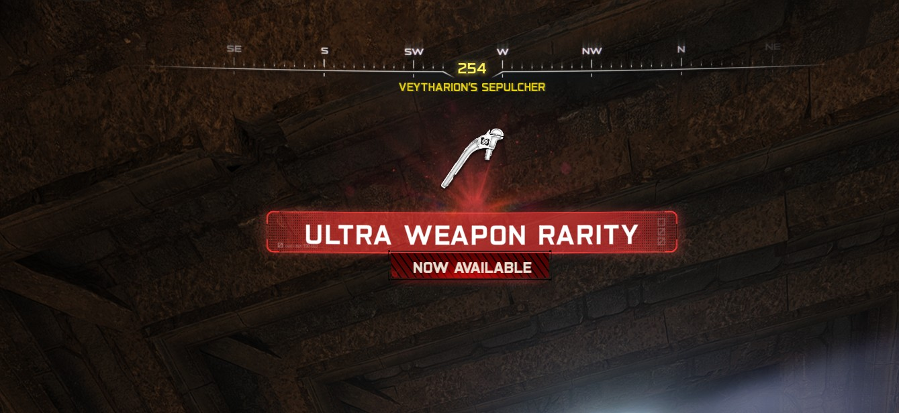
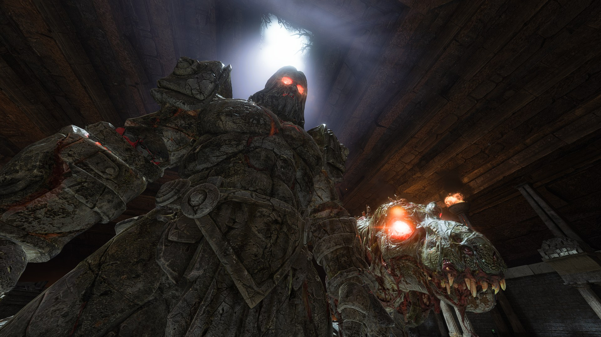
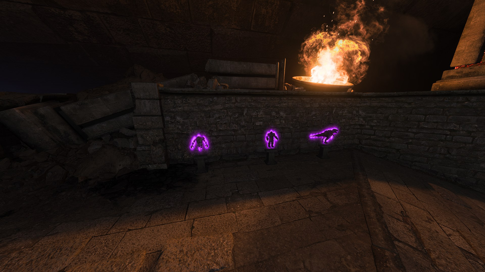
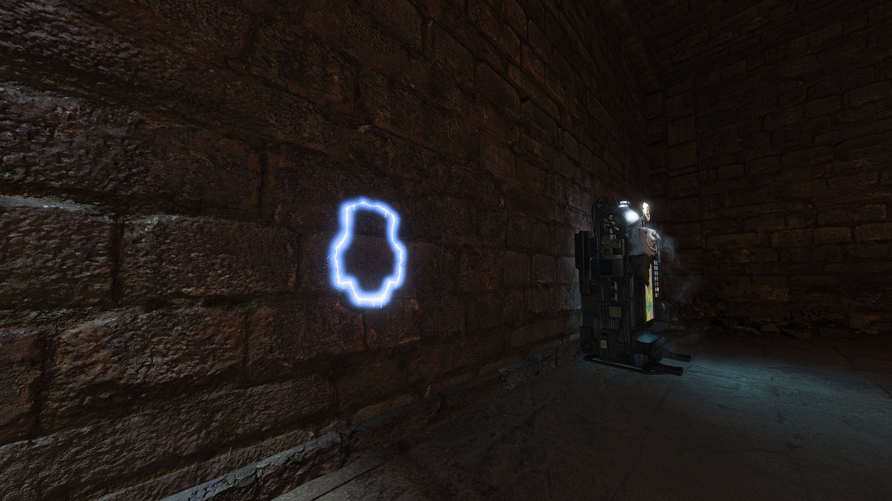

# Veytharion's Gauntlet

A boss arena Survival mode for **Black Ops 7 Zombies** on Rex Infernus, made for **Kronos**.

Drop into the boss arena of Rex Infernus and survive. Jump straight to any boss round from the pedestals, beat each boss for an upgrade that lasts the rest of the match, and take on Z-Rex, the Guardian, Caltheris and the Warden together at round 999.

**Website:** https://dellxcell.github.io/Veytharion-Gauntlet/

## Download

Install it from the **Kronos Workshop**, or get the zip from **[Releases](https://github.com/DellxCell/Veytharion-Gauntlet/releases)** and follow [Install](#install) below.

You'll find it in **Zombies > Survival > Veytharion's Gauntlet**, in Play Solo and Play in a Squad (up to 4 players).

## Features

**Boss rounds**

| Round | Bosses | Reward |
| --- | --- | --- |
| 50 | Z-Rex | Golden Armor for every player |
| 75 | The Guardian | Ultra weapon rarity, also added to the Arsenal |
| 100 | Caltheris | Pack-a-Punch IV |
| 255 | Z-Rex and the Guardian | |
| 500 | Z-Rex, the Guardian and Caltheris | |
| 999 | Z-Rex, the Guardian, Caltheris and the Warden | The end of the gauntlet |

- **5,000 salvage** for every player each time a boss is beaten, in every boss round
- **Boss drops:** like Boss Rush, every boss drops Max Ammo, Full Power, a Free Perk and Max Armor
- **Prepare timer:** a Boss Rush countdown before every fight (30 seconds for one boss, 60 when they fight together), with no zombies spawning
- **Health bars:** every boss has its own bar, side by side when bosses fight together
- **Round skip:** when the last boss of a round dies, the round ends right away
- **Caltheris gets tougher:** phase 2 takes half the damage of phase 1, phase 3 a quarter
- **Round 999:** the Warden fakes its death twice, as in Rex's own fight. When it finally dies you get a BOSSES DEFEATED summary, then the game's Continue Playing? vote
- No exfil during a boss fight, and no T.E.D.D. task in a boss round

**In the arena**
- **Round-select pedestals:** six pedestals, one per boss round, with Rex's Easter egg toys of their bosses floating above them. Walk up and the toys glow purple; press Use to go to that round. They're off while a boss fight is on
- **Void Claw and the Void Talon:** three of Rex's Void Claw pedestals, as in Rex's own boss fight. Beat Z-Rex, the Guardian and Caltheris and the Void Claw becomes the **Void Talon**, with unlimited uses for the rest of the match (a popup tracks VOID TALON 1/3, 2/3). The round-999 fight gives unlimited uses either way
- **Drop-in:** you drop into the arena from above, like the ride down from Tyr in Totenreich

**Machines**
- **Mystery Box** with four wonder weapons: the Ray Gun, the Ray Gun Mark II, the Warden Blight (Rex Infernus' own) and the Necrofluid Gauntlet from Ashes of the Damned
- **Wonderbar** gives the Warden Blight about half the time, and never a second one if you're already holding it
- **Pack-a-Punch**, **Der Wunderfizz** (from round 1, no power needed), **the Arsenal** and the **GobbleGum machine**
- **Armor wall buy** next to the Wunderfizz
- **Rampage Inducer:** turn it on when you want the rounds to speed up
- **T.E.D.D. Tasks** and **Exfil**

**Also**
- No super sprinters
- Half-price ammo at ammo caches and ammo stations
- Clean screen: the minimap and the objective tracker are hidden
- Custom loading intro: four pictures of the arena pan across the loading screen
- Rex's own zombies and special rounds

## Screenshots

| Z-Rex | The Guardian | Caltheris |
| --- | --- | --- |
|  |  |  |

| Round-select pedestals | Mystery Box |
| --- | --- |
|  |  |

| Armor wall buy | T.E.D.D. Tasks |
| --- | --- |
|  |  |

## What's new

**1.2.1**
- **Wonderbar** gives the Warden Blight about half the time (it was about 1 in 4), and never a second one if you're already holding it.
- **5,000 salvage** for every player for each boss beaten.
- **Caltheris** is tougher in her last two phases: half the damage in phase 2 and a quarter in phase 3. Before, she took full damage and went down fast.
- Fixes: a player who leaves a squad match no longer leaves toy glows behind; a Warden end with no players left no longer stops the script; some old test code is gone.

**1.1.3**
- **Fixed: effects missing for the whole match.** The round-select toys' 166 glows used up the game's room for effects. Now only the pedestal you're standing at glows.

**1.1**
- Mystery Box wonder weapons: the Ray Gun, the Ray Gun Mark II, the Warden Blight and the Necrofluid Gauntlet.

## Requirements

- Black Ops 7 with **Kronos** set up (run the Kronos launcher at least once)
- No other files needed: it doesn't replace any Kronos or game files

## Install

**From the Kronos Workshop:** find Veytharion's Gauntlet and install it.

**By hand:**

1. Download **[Veytharions-Gauntlet-1.2.1.zip](https://github.com/DellxCell/Veytharion-Gauntlet/releases/download/v1.2.1/Veytharions-Gauntlet-1.2.1.zip)** from the [latest release](https://github.com/DellxCell/Veytharion-Gauntlet/releases/latest).
2. Close Black Ops 7 and KronosLauncher completely.
3. Extract the zip into `C:\Kronos\cod25\kronos\mods`. You should end up with `C:\Kronos\cod25\kronos\mods\rex_arena\mod.json`, plus the `scripts`, `lua` and `images` folders next to it.
4. Launch the game through Kronos as usual.

The release also lists the mod's files one by one, without folders. Those are for the Kronos Workshop, which puts each file in its folder for you. To install by hand, use the zip.

> [!NOTE]
> Veytharion's Gauntlet is a Kronos mod in its own folder. It doesn't replace any Kronos or game files, and no DLLs or system files are involved. To remove it, delete `C:\Kronos\cod25\kronos\mods\rex_arena`.

## Known issues

- **Avoid Save & Quit** in the gauntlet. Saving and resuming in the arena hasn't been tested.
- Now and then the game crashes while the match is loading in. Start the match again.
- **Carry-forward crash:** with **Carry-forward** on in KronosLauncher, some launches start badly because Kronos' carry-forward weapon setup doesn't finish loading. The drop-in can then freeze on the white screen or right after landing, and the game can crash. Close the game completely, launch it again through Kronos and start the match again. Turning carry-forward off avoids these bad launches.
- Beaten bosses' bodies stay in the arena for the rest of the match.
- With Wonderbar, the box can give you a wonder weapon you already hold, except the Warden Blight.
- Squad play hasn't been fully tested yet.

---

Made by **DellxCell** (The Hamster).
