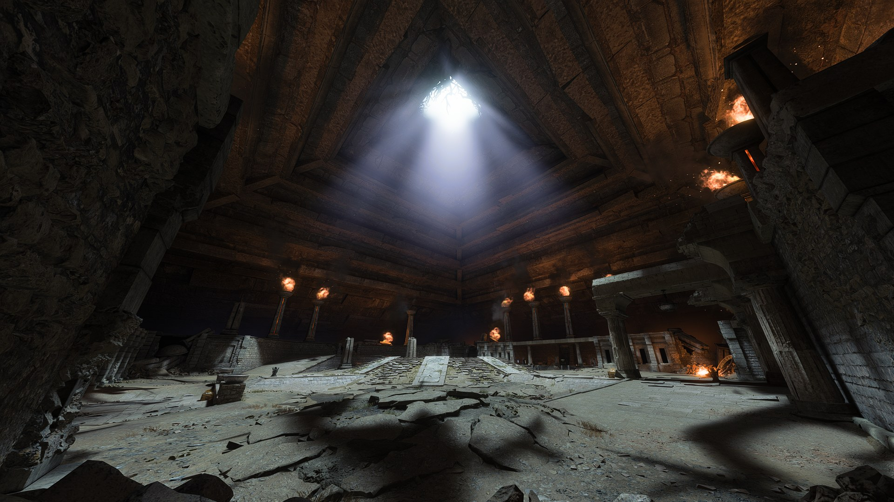
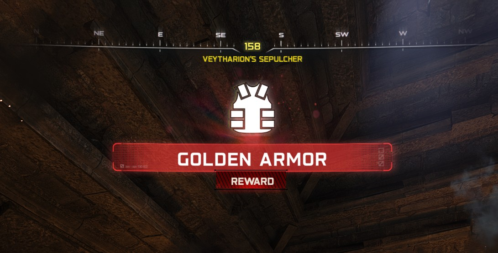
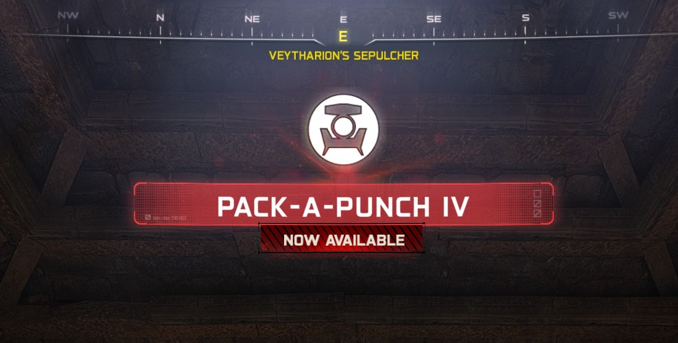
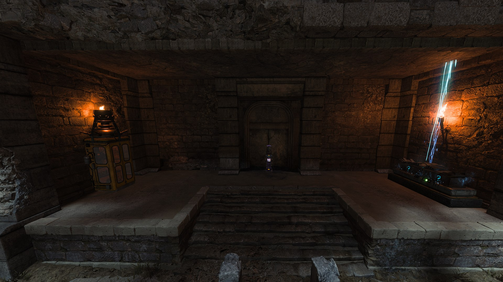
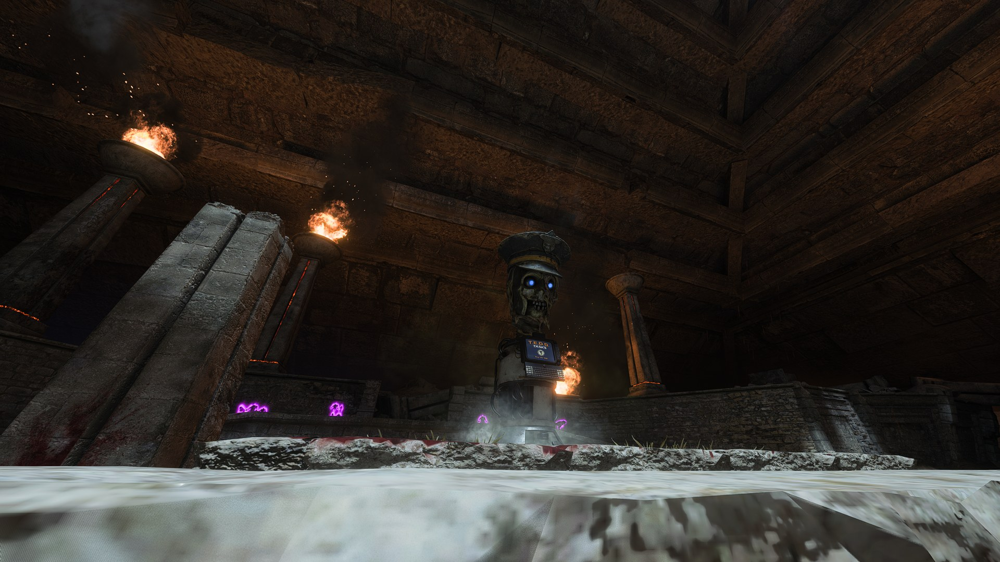

# Veytharion's Gauntlet

**A boss arena Survival mode for Black Ops 7 Zombies on Rex Infernus (Kronos)**
by DellxCell (The Hamster) · version 1.1

Drop into the boss arena of Rex Infernus and survive. Jump straight to a boss round from the pedestals, beat each boss for an upgrade that lasts the rest of the match, and take on Z-Rex, the Guardian, Caltheris and the Warden together at round 999.

## Modes

| Mode | Where to find it | Players |
| --- | --- | --- |
| Survival | Zombies > Survival > Veytharion's Gauntlet (in Play Solo and Play in a Squad) | Solo, or a squad of up to 4 |

## Boss rounds

| Round | Bosses | Reward |
| --- | --- | --- |
| 50 | Z-Rex | Golden Armor for every player |
| 75 | The Guardian | Ultra weapon rarity, also added to the Arsenal |
| 100 | Caltheris | Pack-a-Punch IV |
| 255 | Z-Rex and the Guardian | |
| 500 | Z-Rex, the Guardian and Caltheris | |
| 999 | Z-Rex, the Guardian, Caltheris and the Warden | The end of the gauntlet |

The bosses come at these rounds whether you play up to them or jump there from a pedestal.

- **Prepare timer:** like Boss Rush, every boss fight starts with a countdown. It's 30 seconds for a single boss and 60 seconds when bosses fight together. No zombies spawn during it.
- **Health bars:** every boss has its own health bar, and when bosses fight together their bars sit side by side.
- **Rewards:** each reward shows the game's own popup.
- **Boss drops:** like Boss Rush, every boss you kill drops Max Ammo, Full Power, a Free Perk and Max Armor.
- **Round skip:** when the last boss of a round dies, the round ends right away.
- **Round 999:** the Warden fakes its death twice, as in Rex's own fight. When it finally dies you get a BOSSES DEFEATED summary, then the game's Continue Playing? vote.
- **No exfil during a boss fight**, and no T.E.D.D. task in a boss round.

| Z-Rex | The Guardian | Caltheris |
| --- | --- | --- |
|  |  |  |

## What's in the arena

### Round-select pedestals

Six pedestals, one for each boss round, stand in the east section of the arena. Each one holds Rex's Easter egg toys of its bosses, floating and glowing purple. Press Use at a pedestal to go to its round. The pedestals are off while a boss fight is on.

### Void Claw and the Void Talon

Three of Rex's Void Claw pedestals stand in the arena, as in Rex's own boss fight. Beat Z-Rex, the Guardian and Caltheris and the Void Claw upgrades to the **Void Talon**, with unlimited uses for the rest of the match. A popup tracks your progress after each fight (VOID TALON 1/3, 2/3). The round 999 fight gives unlimited uses either way.

### Machines

- **Pack-a-Punch**
- **Der Wunderfizz,** from round 1, no power needed
- **Mystery Box,** with four wonder weapons: the Ray Gun, the Ray Gun Mark II, Rex Infernus' own wonder weapon and the Necrofluid Gauntlet from Ashes of the Damned
- **The Arsenal**
- **GobbleGum machine**
- **Armor wall buy** next to the Wunderfizz
- **Rampage Inducer:** turn it on when you want the rounds to speed up
- **T.E.D.D. Tasks**
- **Exfil**

### Also in the gauntlet

- **Drop-in:** you drop into the arena from above, like the ride down from Tyr in Totenreich.
- **No super sprinters.**
- **Half-price ammo** at ammo caches and ammo stations.
- **Clean screen:** the minimap and the objective tracker are hidden.
- **Custom loading intro:** four pictures of the arena pan across the loading screen. The lobby card and loading screen show Veytharion's Gauntlet, Survival.
- Rex's own zombies and special rounds.

## Install

**From the Kronos Workshop:** find Veytharion's Gauntlet and install it.

**By hand:**

1. Close Black Ops 7 and KronosLauncher completely.
2. Copy the `rex_arena` folder into `C:\Kronos\cod25\kronos\mods`.
3. Launch the game through Kronos as usual.

> [!NOTE]
> Veytharion's Gauntlet is a Kronos mod in its own folder. It doesn't replace any Kronos or game files, and no DLLs or system files are involved. To remove it, delete `C:\Kronos\cod25\kronos\mods\rex_arena`.

## Known issues

- Avoid Save & Quit in the gauntlet. Saving and resuming in the arena hasn't been tested.
- Now and then the game crashes while the match is loading in. Start the match again.
- **Carry-forward crash:** with **Carry-forward** turned on in KronosLauncher, some game launches start badly because Kronos' carry-forward weapon setup doesn't finish loading. On those launches the drop-in can freeze on the white screen or right after landing, and the game can then crash. If that happens, close the game completely, launch it again through Kronos, and start the match again. Turning carry-forward off avoids these bad launches, but the game can still crash now and then while the match loads.
- Squad play hasn't been fully tested yet.
- The Mystery Box wonder weapons are new in 1.1. If you already hold the Necrofluid Gauntlet, the box can give it to you again.
